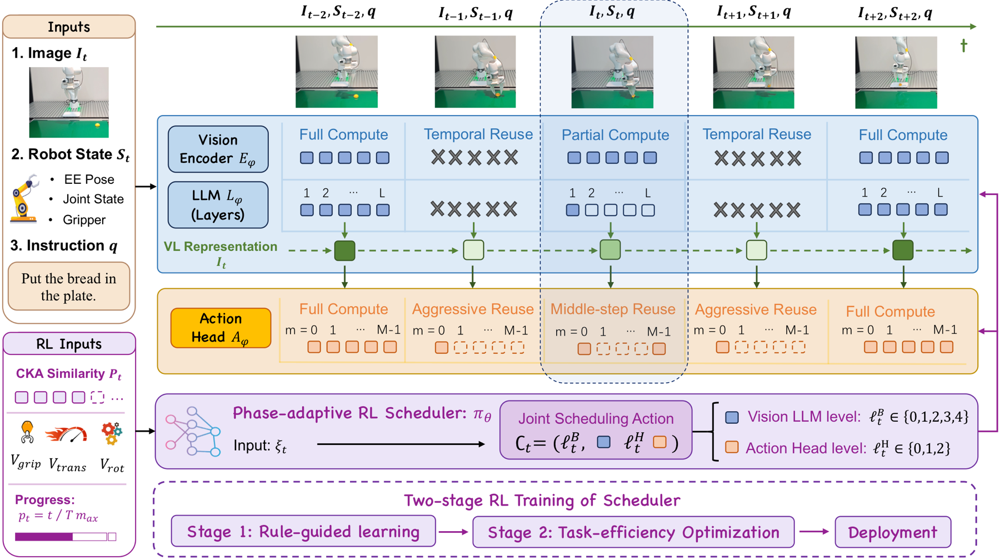
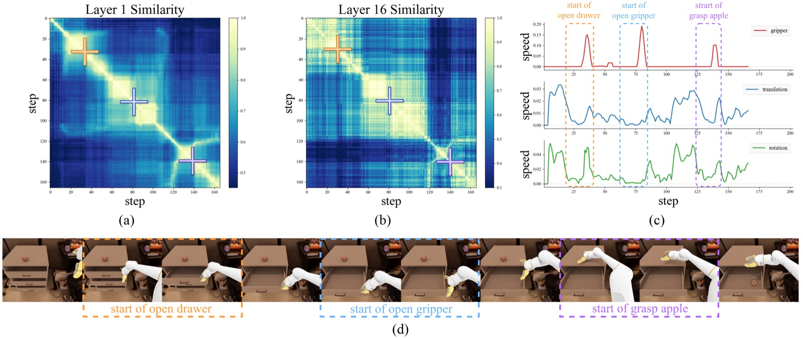
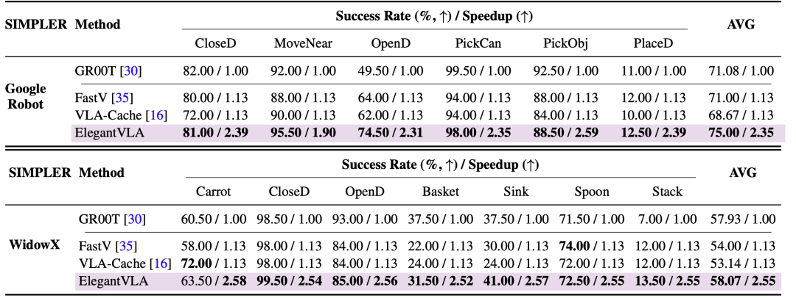
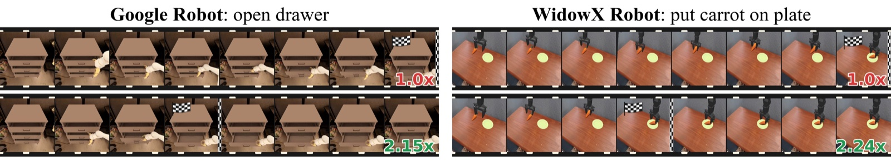

<h1 align="center">ElegantVLA: Learning When to Think for Efficient Vision-Language-Action Models</h1>

<p align="center"><b>NeurIPS 2026</b></p>

<p align="center">
  <a href="https://childtang.github.io/">Ye Li</a>, Huanan Liu, <a href="https://ky-ji.github.io/">Kangye Ji</a>, <a href="https://mengyuan404.github.io/">Yuan Meng</a>, <a href="https://www.jiajunfan.com/">Jiajun Fan</a>, Yuansong Wang, Shiyu Qin, Chenglei Wu, <a href="https://www.sigs.tsinghua.edu.cn/xst/main.psp">Shu-Tao Xia</a>, <a href="https://mmlab-sigs.github.io/groups/zwang/">Zhi Wang</a>
</p>

<p align="center">
  <a href="https://arxiv.org/abs/2605.29438"></a>
  <a href="https://childtang.github.io/ElegantVLA/"></a>
  <a href="checkpoints/gr00t/google_robot"></a>
  <a href="LICENSE"></a>
  <a href="https://www.python.org/"></a>
</p>

ElegantVLA is a plug-in, phase-adaptive inference framework for VLA models. A
lightweight learned scheduler decides **at every control step** how much of the
VLA to recompute, covering the vision encoder, the LLM and the action head, and
reuses earlier computation when the scene and the robot motion are stable. The
base VLA is neither modified nor retrained.

<p align="center">
  
</p>

## Contents

- [Method](#method)
- [Results](#results)
- [Installation](#installation)
- [Evaluation](#evaluation)
- [Training](#training)
- [Other entry points](#other-entry-points)
- [Repository layout](#repository-layout)
- [Tests](#tests)
- [License](#license)
- [Acknowledgements](#acknowledgements)
- [Citation](#citation)

## Method

Not every control step needs full reasoning. While the arm moves smoothly through
free space, the visual-language representation hardly changes; contact and
goal-sensitive phases need fresh computation. ElegantVLA turns this into a
per-step scheduling problem.

<p align="center">
  
</p>

**Observation.** The scheduler uses a 5-dimensional input: the CKA similarity
between the current first-LLM-layer hidden states and those of the last full
computation, end-effector translation, rotation and gripper speed, and episode
progress.

**Vision-LLM compute levels** (`BackboneAction` in `elegantvla/scheduling/types.py`):

| Level | Code name | Computation |
|---|---|---|
| 0 | `REFRESH` | Vision encoder and full LLM; refreshes the anchor representation |
| 1 | `REUSE` | Vision encoder plus first and last LLM layers; reuses intermediate LLM states |
| 2–4 | `REUSE_THEN_NO_IMAGE_{1,2,3}` | Skips the vision encoder and the LLM for 1–3 consecutive steps, reusing the latest representation |

**Action-head levels** (`ActionHeadAction`):

| Level | Code name | Computation |
|---|---|---|
| 0 | `REFRESH` | Full iterative denoising |
| 1 | `REUSE_MIDDLE` | Reuses the intermediate denoising steps |
| 2 | `REUSE_ALL_BUT_FIRST` | Runs only the first denoising step and reuses the rest |

**Scheduler.** A small MaskablePPO policy chooses one level for the backbone and
one for the action head at each step. Training has two stages. Stage 1 imitates
a threshold-based teacher policy. Stage 2 adds a penalty whenever the scheduler
computes more than the teacher, which pushes it toward more reuse.

## Results

Simulation results on GR00T in SimplerEnv. Each cell reports success rate (%) /
speedup.

<p align="center">
  
</p>

<p align="center">
  
</p>

## Installation

Requirements: Linux, an NVIDIA GPU with bf16 and FlashAttention 2 support (tested
on RTX 4090 and A40; V100 is not supported), a Vulkan-capable driver for the
SAPIEN renderer, and [uv](https://github.com/astral-sh/uv).

**1. Clone with submodules.** Isaac-GR00T is pinned at `ead52833` (`n1.6-release`)
and brings SimplerEnv and ManiSkill2_real2sim as nested submodules.

```bash
git clone --recurse-submodules https://github.com/ChildTang/ElegantVLA.git
cd ElegantVLA
# if already cloned: git submodule update --init --recursive
```

**2. Create the GR00T environment and install SimplerEnv into it.** ElegantVLA
runs the simulator in the same process as the policy.

```bash
cd third_party/Isaac-GR00T
uv sync --python 3.10
source .venv/bin/activate
uv pip install -e .
uv pip install -e external_dependencies/SimplerEnv/ManiSkill2_real2sim
uv pip install -e external_dependencies/SimplerEnv
cd ../..
```

**3. Disable the ray-tracing denoiser.** The drawer tasks render with ray tracing.
The released results were obtained with the denoiser off, which also avoids the
OptiX dependency. The patch makes it opt-in via `MS2_RT_USE_DENOISER=1`.

```bash
git -C third_party/Isaac-GR00T/external_dependencies/SimplerEnv/ManiSkill2_real2sim \
    apply "$PWD/patches/ManiSkill2_real2sim_rt_denoiser.patch"
```

**4. Install the ElegantVLA hooks into Isaac-GR00T, then install this package.**

```bash
bash scripts/install_gr00t_integration.sh      # --check validates without copying
uv pip install -e .
```

The installer copies `elegantvla/gr00t/integration/` into the Isaac-GR00T tree.
Besides the ElegantVLA hooks (model, policy, SimplerEnv wrapper, fused kernels),
it carries 16 upstream files (state/action processing, image augmentation, Eagle
configuration and processor, data types) at their GR00T-N1.6 release versions.
The fractal policy and the released scheduler expect these versions, so do not
skip this step. The installer refuses to overwrite files that have local edits.

**5. Download the base policy.**

```bash
huggingface-cli download nvidia/GR00T-N1.6-fractal --local-dir checkpoints/GR00T-N1.6-fractal
export MODEL_PATH=$PWD/checkpoints/GR00T-N1.6-fractal
```

Tested versions: Python 3.10, PyTorch 2.7.1, transformers 4.51.3, flash-attn
2.7.4.post1, numpy 1.26.4, sapien 2.2.2, gymnasium 1.2.3, stable-baselines3 /
sb3-contrib 2.8.0.

<details>
<summary>Troubleshooting</summary>

- **NumPy 2 in the environment.** sapien 2.2.2 is built against NumPy 1.x. Either
  pin `numpy==1.26.4`, or install `numpy<2` into a separate directory and pass it
  as `SIMPLERENV_SITE_PACKAGES=/path/to/dir`; the launch scripts put it on
  `PYTHONPATH` ahead of the environment.
- **Rendering errors from SAPIEN.** Check that the NVIDIA Vulkan ICD is installed
  (`vulkaninfo` should list your GPU) and that `DISPLAY` is unset on headless
  machines.
- **External SimplerEnv checkout.** Set `SIMPLERENV_ROOT` to a directory that
  contains the `simpler_env` package.
- **CPU threads.** `ELEGANTVLA_CPU_THREADS` sets BLAS/OpenMP threads per process
  (default 1), which keeps several parallel evaluations from oversubscribing the CPU.

</details>

## Evaluation

```bash
CUDA_VISIBLE_DEVICES=0 bash elegantvla/gr00t/scripts/eval_google_robot.sh
```

The script evaluates the six tasks one after another (200 episodes each, about
1–2.5 hours per task on one GPU) and prints the results table at the end. For each
task it writes `aggregate.json`, `episodes.jsonl` and `decision_trace.jsonl` under
`outputs/gr00t/google_robot/<task>/`. Finished tasks are skipped, so you can rerun
the script to resume.

Options (environment variables):

| Variable | Default | |
|---|---|---|
| `MODEL_PATH` | required | GR00T-N1.6-fractal directory |
| `CHECKPOINT` | `checkpoints/gr00t/google_robot/ppo_schedule.zip` | Scheduler to evaluate |
| `TASKS` | all six | Space-separated subset, e.g. `"google_robot_open_drawer google_robot_move_near"` |
| `EPISODES` | `200` | Episodes per task |
| `OUTPUT_ROOT` | `outputs/gr00t/google_robot` | Output directory |
| `PYTHON_BIN` | `python3` | Interpreter |

To use several GPUs, start one copy per GPU with disjoint `TASKS` and the same
`OUTPUT_ROOT`, then print the combined table:

```bash
python -m elegantvla.gr00t.tools.speedup outputs/gr00t/google_robot/*
```

Speedup is computed from FLOPs, not wall-clock time. The cost of each step is the
backbone level that actually ran plus the action-head level, using the per-level
costs listed in `elegantvla/gr00t/tools/speedup.py`. The average over tasks
weights each task by its number of steps.

## Training

```bash
CUDA_VISIBLE_DEVICES=0 bash elegantvla/gr00t/scripts/train_google_robot.sh
```

Training runs PPO over the six Google Robot tasks in round-robin, 12 episodes per
update, using the hyperparameters in
`checkpoints/gr00t/google_robot/training_config.json`:

| Stage | Initialization | Reward | Episodes |
|---|---|---|---|
| 1 | Random | Imitate the threshold teacher policy | 1,200 (two runs of 600) |
| 2 | Stage 1 checkpoint | Stage 1 reward plus a conservativeness penalty when the scheduler computes more than the teacher (backbone 0.05, action head 0.025, per step) | 1,200 |

By default both stages run and write
`outputs/gr00t/rl_train/google_robot/{stage1/phase2,stage2}/ppo_schedule.zip`.

| Variable | |
|---|---|
| `STAGE` | `1`, `2` or `all` (default) |
| `STAGE1_CHECKPOINT` | Stage 1 checkpoint to start Stage 2 from |
| `SAVE_ROOT` | Output directory |

Extra arguments are passed to the trainer, for example `--use-wandb` to log to
Weights & Biases. To evaluate a trained scheduler, run the evaluation script with
`CHECKPOINT=/path/to/ppo_schedule.zip`.

## Other entry points

```bash
bash elegantvla/gr00t/scripts/run.sh eval_rl --help     # evaluate a scheduler on any task
bash elegantvla/gr00t/scripts/run.sh train_rl --help    # all training options
bash elegantvla/gr00t/scripts/run.sh evaluate --help    # threshold teacher policy, no RL
bash elegantvla/gr00t/scripts/run.sh benchmark --help   # per-step latency benchmark
```

See [elegantvla/gr00t/README.md](elegantvla/gr00t/README.md) for module roles and
optional GPU runtime switches.

## Repository layout

```text
ElegantVLA/
├── elegantvla/
│   ├── scheduling/          # schedule actions, threshold teacher, RL policy wrapper, cache controller
│   └── gr00t/
│       ├── core/            # GR00T adapter, action-head cache, policy wrapper, RL environment
│       ├── entrypoints/     # eval_rl, train_rl, evaluate, benchmark
│       ├── integration/     # files installed into Isaac-GR00T
│       ├── scripts/         # eval_google_robot.sh, train_google_robot.sh, run.sh
│       ├── tools/           # speedup.py
│       └── tests/           # GPU regression tests for the cache paths
├── checkpoints/gr00t/google_robot/   # released scheduler
├── LICENSES/                         # third-party licenses and notices
├── patches/                          # SimplerEnv rendering patch
├── scripts/install_gr00t_integration.sh
├── third_party/Isaac-GR00T/          # pinned submodule
└── tests/                            # dependency-free checks
```

## Tests

```bash
python -m unittest discover -s tests       # no GPU or model needed
python -m pytest elegantvla/gr00t/tests    # needs the GR00T environment and a GPU
```

Some internal identifiers (for example `TemporalSkipEnv` and the `temporal_skip`
key in policy outputs) keep their original names for compatibility with the
integration hooks and recorded traces.

## License

ElegantVLA is released under the [MIT License](LICENSE). The files under
`elegantvla/gr00t/integration/` are derived from
[Isaac-GR00T](https://github.com/NVIDIA/Isaac-GR00T) and remain under the
[NVIDIA License](LICENSES/NVIDIA-LICENSE.txt), which permits non-commercial
research use only. The GR00T-N1.6 model weights are subject to their own license
on Hugging Face. See [LICENSES/THIRD_PARTY_NOTICES.md](LICENSES/THIRD_PARTY_NOTICES.md)
for details.

## Acknowledgements

This project builds on [Isaac-GR00T](https://github.com/NVIDIA/Isaac-GR00T),
[SimplerEnv](https://github.com/simpler-env/SimplerEnv) and
[Stable-Baselines3](https://github.com/DLR-RM/stable-baselines3) /
[SB3-Contrib](https://github.com/Stable-Baselines-Team/stable-baselines3-contrib).

## Citation

```bibtex
@article{li2026elegantvla,
  title={ElegantVLA: Learning When to Think for Efficient Vision-Language-Action Models},
  author={Li, Ye and Liu, Huanan and Ji, Kangye and Meng, Yuan and Fan, Jiajun and Wang, Yuansong and Qin, Shiyu and Wu, Chenglei and Xia, Shu-Tao and Wang, Zhi},
  journal={arXiv preprint arXiv:2605.29438},
  year={2026}
}
```
